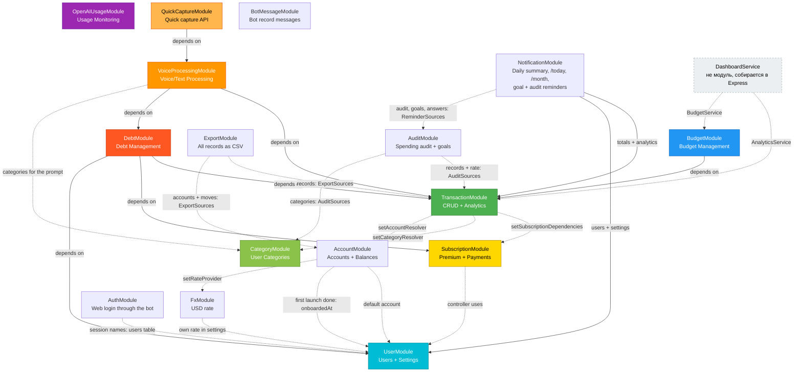

# Module System

`createModules()` (`src/appModules.ts`) возвращает **16 модулей приложения**, каждый с чётко определённой ответственностью. `CategoryModule` добавлен в FT-099, `AccountModule` — в FT-101, `FxModule` — в FT-102, `BotMessageModule` — в FT-122, `NotificationModule` — в FT-124, `ExportModule` — в FT-126, `AuthModule` — в FT-128, `AuditModule` — в FT-131, `QuickCaptureModule` — обёртка над текстовым разбором для `POST /api/quick-capture`.

Dashboard модулем не является: в `src/modules/dashboard/` лежат только `DashboardService` и `DashboardController`, файла `dashboardModule.ts` нет. Сборка происходит в Express-слое — см. [Dashboard: сервис, а не модуль](#dashboard-сервис-а-не-модуль).

## Module Dependencies



## Module Overview

| Модуль | Роль | Зависимости | Ключевые файлы |
|--------|------|-------------|----------------|
| **TransactionModule** | Core: транзакции и аналитика | Независимый при создании; позже получает Subscription + User через `setSubscriptionDependencies()` | `transactionModule.ts` |
| **BudgetModule** | Управление бюджетами | TransactionModule | `budgetModule.ts` |
| **DebtModule** | Управление долгами | TransactionModule, SubscriptionModule, UserModule | `debtModule.ts` |
| **VoiceProcessingModule** | AI обработка голоса/текста | TransactionModule, DebtModule (не используется с Д2), категории пользователя для промпта, выученные слова для правила догадки о категории (FT-138) | `voiceProcessingModule.ts` |
| **QuickCaptureModule** | `POST /api/quick-capture` поверх текстового разбора; `POST /api/quick-capture/payment` — оплата Apple Pay готовой суммой (FT-176, `RecordPaymentUseCase`) | VoiceProcessingModule | `quickCaptureModule.ts` |
| **AccountModule** | Счета (FT-101): остатки на чтении, итог в сумах, счёт новой записи | Независимый; TransactionModule получает его как `AccountResolver`; счёт по умолчанию — из настроек UserModule | `accountModule.ts` |
| **FxModule** | Курс доллара (FT-102): ЦБ по датам, свой курс, действующий курс | Свой курс хранится в настройках UserModule; AccountModule получает его как `EffectiveRateProvider` | `fxModule.ts` |
| **CategoryModule** | Категории пользователя (FT-099): 8 + 8 стартовых, переименование, цвет, скрытие; разрешение категории записи | Независимый; TransactionModule получает его как `CategoryResolver` | `categoryModule.ts` |
| **OpenAIUsageModule** | Мониторинг OpenAI costs | Независимый | `openAIUsageModule.ts` |
| **SubscriptionModule** | Premium подписки + Telegram Stars | UserModule (controller) | `subscriptionModule.ts` |
| **UserModule** | Пользователи и их настройки (FT-098) | Независимый | `userModule.ts` |
| **BotMessageModule** | Сообщения бота о записях (FT-122): какие записи показывает подтверждение и какой экран кнопок открыт — таблица `bot_messages`, кнопки и `/undo` переживают перезапуск | Независимый; записи меняет бот через use cases TransactionModule | `botMessageModule.ts` |
| **NotificationModule** | Уведомления бота: итоги дня в выбранное время по часам пользователя и итоги для `/today` и `/month` (FT-124); напоминания после ревизии — цель на 80% и сверх лимита, подписка накануне списания, ревизия 1-го числа и «Позже» один раз (FT-133); каждое — не больше одного раза (`notifications_log`) | TransactionModule (сервис итогов FT-103, аналитика FT-120), UserModule (пользователи и настройки), AuditModule (ревизия, цели и ответы на напоминания — порт `ReminderSources`) | `notificationModule.ts` |
| **AuthModule** | Вход в браузере через бота (FT-128, Д4): одноразовая ссылка `t.me/<bot>?start=login_<token>` на 5 минут, «Подтвердить» / «Это не я» в боте, сессия браузера — httpOnly-cookie; `login_tokens` | Независимый; имена для `GET /api/auth/session` — из UserModule в контроллере; сессию читает `webSessionMiddleware` в Express | `authModule.ts` |
| **AuditModule** | Ревизия трат и цели (FT-130 правила, FT-131 хранение): ревизия прошлого месяца открывается при первом запросе и хранит кандидатов с решениями (`audits`), «Готово» делает цели (`goals`) — лимит с дня ревизии, сравнение с теми же днями прошлого месяца, подписки «Уже отменено» / «Напомнить»; неразобранное приходит в следующую ревизию | TransactionModule (записи, первая запись, курс через сервис итогов FT-103) и CategoryModule через порт `AuditSources` (подключается в `createModules()`) | `auditModule.ts` |
| **ExportModule** | «Скачать все записи» (FT-126): CSV всех неудалённых записей и перемещений — скачивание в браузере (`GET /api/export`) или файл в чат с ботом (`POST /api/export/chat`, `sendDocument`) | TransactionModule и AccountModule через порт `ExportSources` (подключается в `createModules()`); Bot API — по токену бота | `exportModule.ts` |

Отдельно, **не как модуль**:

| Компонент | Роль | Зависимости | Ключевые файлы |
|-----------|------|-------------|----------------|
| `DashboardService` / `DashboardController` | Агрегация insights для dashboard-эндпоинтов | AnalyticsService (Transaction) + BudgetService (Budget) | `src/modules/dashboard/application/services/dashboardService.ts`, `src/modules/dashboard/presentation/controllers/dashboardController.ts` |

---

## 1. TransactionModule

**Файл:** [`src/modules/transaction/transactionModule.ts`](../../../src/modules/transaction/transactionModule.ts)

### Назначение
Core module системы — управление финансовыми транзакциями и аналитикой.

### Use Cases
- `CreateTransactionUseCase` - создание транзакции
- `GetTransactionsUseCase` - получение всех транзакций
- `GetUserTransactionsUseCase` - транзакции пользователя
- `UpdateTransactionUseCase` - обновление транзакции; правка категории учит разбор через порт `CategoryLessons`
  (FT-184, `application/teachCategoryCorrection.ts`, реализует `TransactionLearningService`): сначала снимает уроки
  записи (`unlearnRecord`), затем учит магазин оплаты целиком или слова фразы (`lessonWordsOf`, без слов оплаты и
  названий счетов — `AccountResolver.accountNames`); своя категория без `presetKey` не учит
- `DeleteTransactionUseCase` - удаление транзакции
- `UpdateTransactionWithLearningUseCase` - обновление с ML записью по `originalText`/`originalParsing` из тела запроса;
  сейчас так не шлёт ни один клиент

- `GetMonthAnalyticsUseCase`, `GetCategoryAnalyticsUseCase` - аналитика «Пастели» с честным сравнением (FT-120): `GET /api/analytics`, `GET /api/analytics/categories/:id`, каждый в своём файле; общее чтение месяца — `application/analyticsFrame.ts`; правила — `domain/monthAnalytics.ts`, суммы — через `PeriodTotalsService`; категорию ищет порт `CategoryResolver.findForUser`

### Services
- `AnalyticsService` - старая аналитика (summary, categories, trends, patterns)
- `PeriodTotalsService` - итоги периода (FT-103): одно правило для главной, аналитики, дашборда и итогов бота

### Repository
- Interface: `src/modules/transaction/domain/transactionRepository.ts`
- Implementation: `SqliteTransactionRepository` (TypeORM)

### Module Creation
```typescript
const transactionModule = TransactionModule.create();
// Внутри: RepositoryFactory.createTransactionRepository()
```

---

## 2. BudgetModule

**Файл:** [`src/modules/budget/budgetModule.ts`](../../../src/modules/budget/budgetModule.ts)

### Назначение
Управление бюджетами с автоматическим расчетом потраченной суммы.

### Use Cases
- `CreateBudgetUseCase` - создание бюджета
- `GetBudgetsUseCase` - получение бюджетов пользователя
- `UpdateBudgetUseCase` - обновление бюджета
- `DeleteBudgetUseCase` - удаление бюджета

### Services
- `BudgetService` - расчет spent, budget summaries, alerts

### Key Dependency
```typescript
new BudgetService(
  budgetRepository,
  transactionModule.getRepository() // Нужен для расчета spent
)
```

**Почему зависимость?**
Для расчета `spent` нужно суммировать транзакции пользователя в периоде бюджета через `transactionRepository.getByUserIdAndDateRange()`.

---

## 3. DebtModule

**Файл:** [`src/modules/debt/debtModule.ts`](../../../src/modules/debt/debtModule.ts)

### Назначение
Управление долгами (кто кому должен) с историей погашений.

### Use Cases
- `CreateDebtUseCase` - создание долга (+ опциональная транзакция)
- `GetDebtsUseCase` - получение долгов пользователя, summary
- `UpdateDebtUseCase` - обновление и отмена долга
- `DeleteDebtUseCase` - удаление долга
- `PayDebtUseCase` - частичное/полное погашение долга

### Entities
- `Debt` - долг с типом (i_owe / owed_to_me), суммой, статусом
- `DebtPayment` - запись о платеже по долгу

### Key Dependency
```typescript
new CreateDebtUseCase(
  debtRepository,
  transactionModule.getCreateTransactionUseCase() // Для создания linked транзакции
)
```

**Почему зависимость?**
При создании долга с флагом `moneyTransferred=true` создается связанная транзакция (income/expense) для отражения реального движения денег.

### Hybrid Approach
- Долги как отдельная сущность (не транзакции)
- При передаче денег создается linked транзакция
- Баланс отражает реальность
- Долги не загрязняют бюджетную аналитику

---

## 4. SubscriptionModule

**Файл:** [`src/modules/subscription/subscriptionModule.ts`](../../../src/modules/subscription/subscriptionModule.ts)

### Назначение
Freemium модель с Telegram Stars: лимиты для free tier, безлимит для premium.

### Tier System

| Tier | Транзакции | Голосовые | Долги | Аналитика |
|------|------------|-----------|-------|-----------|
| **Free** | 50/месяц | 10/месяц | 5 активных | Скрыта |
| **Premium** | ∞ | ∞ | ∞ | Полная |

### Subscription Sources
- `payment` - оплата через Telegram Stars (100 Stars/месяц)
- `trial` - 14-дневный пробный период
- `gift` - подарок от админа (на определенный период)
- `lifetime` - пожизненный доступ

### Use Cases
- `CreateSubscriptionUseCase` - создание подписки после оплаты
- `GetSubscriptionUseCase` - получение статуса подписки с лимитами
- `CheckLimitUseCase` - проверка лимита перед действием
- `IncrementUsageUseCase` - увеличение счетчика после действия
- `GrantPremiumUseCase` - выдача premium админом
- `StartTrialUseCase` - запуск trial для нового пользователя
- `CancelSubscriptionUseCase` - отмена подписки

### Services
- `SubscriptionService` - проверка premium статуса, обработка истекших подписок

### Entities
- `Subscription` - подписка с tier, source, status, payment info
- `UsageLimit` - счетчики использования для free tier

### Repository
- Interface: `subscriptionRepository.ts`, `usageLimitRepository.ts`
- Implementations: TypeORM (SQLite)

### Key Dependency (Controller Layer)
```typescript
// SubscriptionController получает UserModule для резолва telegram_id → UUID
new SubscriptionController(subscriptionModule, userModule)
```

**Почему зависимость?**
API принимает telegram_id (например, `131184740`), но БД использует UUID. Controller резолвит ID через `GetOrCreateUserUseCase`.

### User ID Resolution

Controller обрабатывает 3 типа user ID:

| ID Type | Пример | Обработка |
|---------|--------|-----------|
| **Guest** | `guest_abc123-...` | Default free tier (без обращения к БД) |
| **Telegram ID** | `131184740` | Резолв через UserModule → UUID |
| **UUID** | `6c7c7a0e-...` | Прямой запрос к БД |

```typescript
// В SubscriptionController
if (this.isGuestUser(userId)) {
  return this.createGuestUserResponse(userId); // Free tier по умолчанию
}
const userUUID = await this.resolveUserId(userId); // telegram_id → UUID
```

### Telegram Stars Integration
```typescript
// Отправка invoice
await telegram.sendInvoice(chatId, {
  title: 'Premium',
  payload: JSON.stringify({ userId, type: 'premium' }),
  provider_token: '', // ПУСТАЯ СТРОКА для Stars!
  currency: 'XTR',
  prices: [{ label: 'Premium', amount: 100 }],
});

// КРИТИЧНО: ответить в течение 10 сек!
bot.on('pre_checkout_query', async (ctx) => {
  await ctx.answerPreCheckoutQuery(true);
});
```

### Middleware
- Express: `checkLimit`, `incrementUsage`, `requirePremium`
- Telegram: `createTelegramCheckLimitMiddleware`, `createTelegramIncrementUsageMiddleware`

---

## 5. VoiceProcessingModule

**Файл:** [`src/modules/voiceProcessing/voiceProcessingModule.ts`](../../../src/modules/voiceProcessing/voiceProcessingModule.ts)

### Назначение
AI-powered обработка голосовых сообщений и текстового ввода в транзакции.

### Use Cases
- `ProcessVoiceInputUseCase` - OGG → MP3 → Whisper → GPT → Transaction
- `ProcessTextInputUseCase` - Text → GPT → Transaction

### Services
- `OpenAITranscriptionService` - Whisper transcription + GPT parsing

### Key Dependency
```typescript
new ProcessVoiceInputUseCase(
  transcriptionService,
  transactionModule.getCreateTransactionUseCase() // Создание транзакции
)
```

**Почему зависимость?**
После парсинга транзакции из голоса/текста, нужно сохранить её через `CreateTransactionUseCase`.

**Порты (domain):** `UserCategorySource` (`categoryPrompt.ts`, реализует `CategoryCatalog`) — категории для
промпта; `LearnedCategoryWords` (`categoryGuess.ts`, реализует `TransactionLearningService`) — выученные слова
по ключу стартовой категории: категория, которую они дают, не догадка ИИ (FT-138, `docs/pastel/api.md`).

---

## 6. OpenAIUsageModule

**Файл:** [`src/modules/openai-usage/openAIUsageModule.ts`](../../../src/modules/openai-usage/openAIUsageModule.ts)

### Назначение
Мониторинг использования и стоимости OpenAI API.

### Use Cases
- `GetOpenAIUsageUseCase` - получение usage data, billing limits, credit balance

### Repository
- `OpenAIUsageRepositoryImpl` - прямые API calls к OpenAI

### Features
- In-memory кеширование (5 минут)
- Расчет процента использования лимитов
- Алерты при приближении к лимиту

---

## 7. UserModule

**Файл:** [`src/modules/user/userModule.ts`](../../../src/modules/user/userModule.ts)

### Назначение
Управление пользователями и резолв внешних идентификаторов (`telegramId` → внутренний UUID).

### Использование
`SubscriptionController` и роутеры транзакций/бюджетов/долгов используют модуль, чтобы принять `telegram_id` во внешнем API и работать с UUID внутри. Маршруты вехи 10 берут пользователя только из авторизации через `createCurrentUserMiddleware(userModule)`.

### Настройки (FT-098)
`GetUserSettingsUseCase`, `UpdateUserSettingsUseCase` и таблица `user_settings`; маршрут `GET/PATCH /api/settings`. Контракт — [`docs/pastel/api.md`](../../pastel/api.md).

---

## 8. CategoryModule

**Файл:** [`src/modules/category/categoryModule.ts`](../../../src/modules/category/categoryModule.ts)

### Назначение
Категории пользователя (FT-099, решение Д5). У каждого 8 расходных и 8 доходных стартовых категорий из дизайна; их можно переименовать, перекрасить в один из 8 пастельных цветов, скрыть («Другое» не скрывается) и добавить свои. Запись хранит `category_id`.

### Состав
- `CategoryCatalog` — создаёт стартовый набор при первом обращении, реализует порт `CategoryResolver` модуля транзакций и `UserCategorySource` модуля разбора.
- `categoryPresets.ts` — стартовые категории и перевод старых 26 + 7 id, названий и синонимов в новые с учётом типа записи.
- `ListCategoriesUseCase`, `CreateCategoryUseCase`, `UpdateCategoryUseCase` — `GET/POST /api/categories`, `PATCH /api/categories/:id`.
- `DeleteCategoryUseCase` — `DELETE /api/categories/:id` (FT-127): «Отменить» после «Категория добавлена» удаляет свою категорию, пока в ней нет записей (удалённые тоже считаются); стартовую и «Другое» — нет.

### Как запись получает категорию
`CreateTransactionUseCase` и обновление спрашивают `CategoryResolver`: id категории (новые клиенты) → своё название без учёта регистра → старый id, название или синоним через стартовую категорию → «Другое» того же типа. Автоматические пути (ИИ, быстрый разбор текста) не кладут запись в скрытую категорию. Смена типа без новой категории переносит запись в одноимённую категорию другого типа или в его «Другое».

---

## 9. AccountModule

**Файл:** [`src/modules/account/accountModule.ts`](../../../src/modules/account/accountModule.ts)

### Назначение
Счета пользователя (FT-101): наличные, карта, доллары. Счёт скрывают, а не удаляют. Пользователю без счетов создаётся «Карта» (UZS); при миграции на неё переехала вся история.

### Состав
- `AccountBook` — создаёт «Карту» при первом обращении, считает остатки (`summary`) и итог видимых счетов в сумах (доллары — через порт `EffectiveRateProvider`, FT-102), реализует порт `AccountResolver` модуля транзакций: выбранный счёт; иначе среди видимых счетов в валюте записи — названный в тексте, затем по виду («нал», «картой»), затем по валюте; иначе счёт по умолчанию из настроек, иначе первый видимый (FT-103). Скрытый счёт для новой записи не выбирается.
- `SqliteAccountRepository.balanceChanges` — остаток считается на чтении одним запросом, без кэша: записи в валюте счёта и неудалённые перемещения с даты открытия; в день открытия — только записанные с момента первого запуска (`opening_at`, FT-163). То же правило для одной операции — `countsInBalance` в `domain/account.ts`, его берёт экран счёта.
- `ListAccountsUseCase`, `CreateAccountUseCase`, `UpdateAccountUseCase` — `GET/POST /api/accounts`, `PATCH /api/accounts/:id`.
- `DeleteAccountUseCase` (FT-118) — `DELETE /api/accounts/:id`: «Отменить» сразу после «Счёт добавлен». Удаляет только счёт без записей и перемещений (удалённые тоже считаются), проверка и удаление — один запрос; иначе `409`, такой счёт скрывают.
- Перемещения (FT-104, таблица `account_moves`): `CreateMoveUseCase` (перевод, обмен с курсом сделки и курсом ЦБ на дату через порт `CbuRateOnDate`, корректировка до введённого остатка), `SetMoveDeletedUseCase` (мягкое удаление и восстановление) — `POST /api/moves`, `DELETE /api/moves/:id`, `POST /api/moves/:id/restore`. Перемещения — не записи, поэтому в аналитику не попадают.
- `GetAccountOperationsUseCase` — `GET /api/accounts/:id/operations`: записи счёта (через порт `AccountRecordSource`, его даёт TransactionModule) и перемещения по дням; с `from` — ещё `earlierDate`, день последней операции раньше окна (экран счёта читает окнами, FT-118).
- `CompleteFirstLaunchUseCase` (FT-109) — `POST /api/accounts/opening-balances`: наличные, карта и доллары становятся начальными остатками «Наличных», «Карты» и «Долларов» с датой сегодня (существующий счёт той же валюты переиспользуется, недостающий создаётся), затем ставится `onboardedAt`. Готов ли первый запуск — через порт `FirstLaunchProgress`; его реализует UserModule (`onboardedAt`, `markOnboarded`), подставляется в `createAccountRoutes`.

---

## 10. FxModule

**Файл:** [`src/modules/fx/fxModule.ts`](../../../src/modules/fx/fxModule.ts)

### Назначение
Курс доллара (FT-102). Курс ЦБ Узбекистана хранится по датам в `fx_rates`, загружается при старте и раз в час, пока нет курса на сегодня; без ответа действует последний известный. Свой курс пользователя — в `user_settings` (`fx_own_rate_minor`, `fx_own_since`) — действует вместо курса ЦБ.

### Состав
- `FxRateService` — `refreshUsd`, `cbuRateOn(date)` (для обменов FT-104), `effectiveUsdRate(userId)` (порт `EffectiveRateProvider` модуля счетов), `setOwnRate`.
- `HttpCbuClient` — запрос к ЦБ с таймаутом 10 с; любая ошибка — «нет ответа», без падения.
- `GET /api/rates/usd`, `PUT` и `DELETE /api/rates/usd/own`; `PUT` с `since` возвращает прежний свой курс с его датой («Отменить» в шторке курса, FT-119).

---

## 11. BotMessageModule

**Файл:** [`src/modules/botMessage/botMessageModule.ts`](../../../src/modules/botMessage/botMessageModule.ts)

### Назначение
Сообщения бота о записях (FT-122). Подтверждение в чате — одно сообщение на фразу; таблица `bot_messages` хранит,
какие записи оно показывает (`record_ids`), какой экран кнопок под ним открыт (`mode`: подтверждение, «Изменить»,
сумма, категория, счёт, дата; с FT-123 — `large`, крупная сумма до подтверждения), последнюю правку и догадки о
категории (`state`; с FT-123 там же «45» → 45 000, названное без суммы, строки «не записал», отказ от крупной суммы),
что бот расслышал (`heard`) и открытый вопрос (`question`, FT-123: выводится из `mode` и `state`). Поэтому
«Изменить», «Вернуть», ответ суммой, «Сколько?» и `/undo` работают и после перезапуска. С FT-172 таблица
`handled_messages` помнит сообщения чата, которые бот обработал (по client id `tg-<bot>-<chat>-<message>`, два дня):
какое сообщение бота изменил ответ на «Сумму» или `/undo` и какое подтверждение записей вот-вот уйдёт — так
сообщение, которое Telegram прислал снова после перезапуска, ничего не меняет второй раз, а не ушедшее подтверждение
уходит таким же, как первое.

### Состав
- `BotMessageLog` — `remember`, `find(chat, message)`, `recent(chat)` (для `/undo`), `awaitingAmount(chat)` (открытый
  вопрос чата — один за раз), `otherQuestions(message)`, `save`; с FT-172 — `handled(clientId)`, `markHandled`,
  `keepConfirmation`, `dropConfirmation` (домен — `handledMessage.ts`).
- Домен — `openQuestion(mode, state)`: что чат ждёт следующим текстом. Тип названного без суммы
  (`ItemWithoutAmount`) берётся из домена VoiceProcessingModule.
- `SqliteBotMessageRepository` — TypeORM; строка на сообщение, уникальна пара `chat_id` + `message_id`.
- Сами записи модуль не трогает: бот меняет их через use cases TransactionModule (`Update`, `Delete`, `Restore`) и
  рисует сообщение заново из базы (`src/delivery/messaging/telegram/utils/recordMessageView.ts`).

---

## 12. NotificationModule

**Файл:** [`src/modules/notification/notificationModule.ts`](../../../src/modules/notification/notificationModule.ts)

### Назначение
Сообщения, которые бот присылает сам (FT-124, FT-133, `docs/pastel/components/BotNotice.md`). Итоги дня: в
выбранное время (`dailySummaryTime`, 20:00–23:00, по умолчанию 21:00) по часовому поясу пользователя
(`users.timezone`) — сумма за день, до 3 категорий и строка о месяце; в день без записей — «Трат правда не было?»,
не больше 2 вечеров подряд и снова после записи, но не до первой записи пользователя. Пришедший после выбранного
времени получает первые итоги на следующий день. Те же итоги отвечают на `/today` и `/month`.

Напоминания после ревизии (FT-133, доска «Бот · напоминания»): цель «Вдвое меньше» — один раз на 80% лимита с дня
ревизии и один раз сверх него, днём (10:00–22:00 по часам пользователя); подписка или тариф с «Напомнить» — в день
напоминания (накануне списания) с 10:00, с «Отменено | Оставить»; ревизия — 1-го числа в `auditTime`, пока в ней есть
траты на проверку, с «Открыть ревизию ↗» и «Позже» — «Позже» зовёт ещё раз на следующий день в то же время, один раз.
Всё — пока включены «Звать на ревизию» (`auditEnabled`) и «Цели и подписки» (`goalAlertsEnabled`).

Опоздавшее догоняем (FT-164, решение 2026-10-29): итоги дня, не ушедшие до полуночи (нет сети или бот не работал весь
вечер), приходят на следующее утро с 08:00 и до конца того дня как «Итоги за вчера · 14 октября» — только за вчера, не
очередью за несколько дней. Догоняется только пользователь, у которого в журнале есть строка `daily_summary` за любой
день раньше вчерашнего — какая угодно, `sent`, `skipped` или `failed`: о новом пользователе бот ничего не знает. Строка
о месяце — до того дня, без записей, сделанных после. Свои итоги дня приходят как обычно; время итогов — 20:00–23:00,
поэтому вчерашние всегда приходят раньше сегодняшних (будь время итогов раньше 08:00, сегодняшние пришли бы первыми).
Напоминание о цели может прийти на следующий день; подписка и ревизия — только в свой день. Подписка и ревизия, чей день
бот пропустил целиком (не работал в их время), не догоняются, но на следующий день получают строку `failed` «не ушло:
ни одной попытки» — ревизия, только если в тот день было что звать (FT-173).

### Состав
- Домен — `dailySummary.ts`: часы пользователя (`localClock`), когда итоги пора слать (`isSummaryDue`), что в них
  (`DaySummary`, `MonthSummary`), правила `DAILY_SUMMARY_RULES`; `notificationLog.ts` — строка журнала и порт
  репозитория; `reminders.ts` (FT-133) — правила напоминаний `REMINDER_RULES` (80%, дневные часы), что они говорят
  (`ReminderNotice`) и порт `ReminderSources` к модулю ревизии; `noticeWindow.ts` (FT-164) — до какого дня не ушедшее
  пробуется снова (`lastDayToSend`), с какого часа догоняется вчерашнее (`NOTICE_WINDOW.catchUpFrom`, 08:00) и что
  пишется в `error` при закрытии (`notSentReason`).
- `noticeAttempts.ts` (FT-164) — общий для обоих планировщиков цикл попытки: занять новое или забрать не ушедшее
  (`claimOrTake`, `takeOpen` — атомарный `UPDATE … SET attempts = attempts + 1 WHERE status = 'not_sent'`), оставить ждать
  (`leaveNotSent`: `sending` → `not_sent` с ошибкой), закрыть просроченное (`closeExpired`: `not_sent` → `failed` с
  причиной «не ушло: нет сети, N попыток, последняя ошибка …»). Строку `sending` не забирает никто — не больше одного раза.
- `SummaryService` — итоги дня и месяца. Числа — из TransactionModule: `GetPeriodTotalsUseCase.forPeriod` (тот же
  сервис итогов, что у плиток главной) и `GetMonthAnalyticsUseCase` (сравнение с теми же днями прошлого месяца).
- `DailySummaryNotifier` — планировщик: раз в минуту смотрит часы каждого пользователя; день сначала занимается в
  `notifications_log` (уникальны пользователь + вид + период), потом читается и отправляется — второй тик,
  перезапуск или второй процесс его не повторят. Не дошедшее (бот заблокирован, таймаут, сброс соединения) остаётся
  `failed` и в тот день не повторяется. Запрос, который точно не ушёл с машины (`ENOTFOUND` / `EAI_AGAIN` после сна,
  `ECONNREFUSED`), отправитель бота бросает как `NoticeNotSentError`: строка остаётся `not_sent` с числом попыток
  (`attempts`) и ошибкой, итог пробуется каждую минуту до конца дня — и после перезапуска (FT-144, FT-164). Первый тик
  следующего дня (раз в день на пользователя): вчерашние итоги, которые не ушли или вовсе не пробовались (строки нет,
  а за какой-нибудь день раньше вчерашнего строка `daily_summary` есть — `hasEarlier`), получают строку
  `daily_summary_late` в ожидании (`not_sent`, 0 попыток) — с 08:00 она уходит как «Итоги за вчера» (`summarySender` с
  `late`) и пробуется до конца дня; всё просроченное закрывается `failed` с причиной, без попыток — «не ушло: ни одной
  попытки» (бот не работал или итоги были выключены — по журналу не различить). Месяц в итогах дня считается до этого
  дня (`throughToday` у `GetMonthAnalyticsUseCase`; экран аналитики и `/month` — весь месяц, FT-141). Пустой вчерашний
  день — тот же вопрос «Трат правда не было?» с подсказкой «вчера обед 45к», он считается в «2 вечера подряд»
  (`lastSent` по обоим видам). «Да, не было» сохраняет ответ, только пока за день нет записей (`answerNoSpending`) — в
  строке того вопроса, что ушёл (вечером или утром), и оставляет заголовок «за вчера»; если запись уже есть, вопрос
  превращается в итоги дня.
- `RemindersNotifier` (FT-133) — планировщик напоминаний, раз в минуту рядом с итогами дня; каждое напоминание
  занимается в `notifications_log` (`goal_near` / `goal_over` — id цели, `subscription` — id цели и день напоминания,
  `audit` / `audit_again` — месяц ревизии) и уходит не больше одного раза; не ушедшее с машины ждёт `not_sent` и
  пробуется, пока напоминание «пора»: цель — до конца следующего дня после первой попытки, остальное — до конца дня
  первой попытки; первый тик после этого закрывает его `failed` с причиной (FT-144, FT-164). Первый тик дня (раз в день
  на пользователя) смотрит вчерашний день: подписка с «Напомнить» без строки за вчера и ревизия 1-го числа без строки,
  где было что звать (`open`, `left > 0`), занимаются в ожидании с последним днём «вчера» и сразу закрываются `failed`
  «не ушло: ни одной попытки» — след без отправки задним числом, только за вчера (FT-173). Цель, сразу ушедшая сверх лимита, получает
  только второе сообщение, первое остаётся `skipped`. «Позже» (`answerAuditLater`) пишет `answer = 'later'` и `due_on` —
  завтра; «Отменено» и «Оставить» (`answerSubscription`) идут в модуль ревизии через `ReminderSources`. Общий таймер
  обоих планировщиков — `Ticker` (`application/ticker.ts`).
- `SqliteNotificationLogRepository` — TypeORM, `INSERT OR IGNORE` + перечитывание (как FT-140); переходы между
  статусами — `transition` (`UPDATE … WHERE id = ? AND status = ?`, из двух тиков выигрывает один).
- Отправляет и рисует бот: `summarySender` и «Да, не было» — `src/delivery/messaging/telegram/handlers/summaryHandlers.ts`,
  тексты — `formatters/summaryMessage.ts`; напоминания, «Позже», «Отменено» и «Оставить» — `handlers/reminderHandlers.ts`
  и `formatters/reminderMessage.ts`. Планировщики запускает `startTelegramBot()`, то есть только процесс,
  который опрашивает Telegram: после ответа Telegram (`onLaunch`), с первым тиком через минуту, и останавливает,
  когда опрос падает (конфликт с другим процессом или ошибка насовсем).

---

## 13. ExportModule

**Файл:** [`src/modules/export/exportModule.ts`](../../../src/modules/export/exportModule.ts)

### Назначение
«Скачать все записи» в «Ещё» (FT-126): один файл `kapelka-<сегодня>.csv` со всеми неудалёнными и неархивными
записями и неудалёнными перемещениями пользователя. В браузере его отдаёт `GET /api/export`, в Telegram
`POST /api/export/chat` отправляет его в личный чат с ботом. Формат — `docs/pastel/api.md`, «Выгрузка всех записей».

### Состав
- Домен — `recordsCsv.ts`: строки файла (перевод и обмен — две строки, «откуда» и «куда»), `;`, десятичная запятая,
  UTF-8 с BOM; `exportPorts.ts`: порты `ExportSources` (записи, перемещения, счета) и `ChatFileSender`, ошибка
  `ChatClosedError` (`422 BOT_CHAT_CLOSED`).
- `BuildRecordsFileUseCase` — файл; `SendRecordsToChatUseCase` — отправка, по одной на пользователя за раз: второй
  запрос, пока файл в пути, — `409`, второй файл не уходит. Без записей файл не отправляется.
- `TelegramChatFileSender` — `sendDocument` через Bot API (`Telegram` из telegraf, не опрашивающий бот), подпись
  «205 записей на 14 октября — …»; 403 и «chat not found» — `ChatClosedError`. Создаётся, если задан
  `TG_BOT_API_KEY`; без него `POST /api/export/chat` отвечает `502`, скачивание работает.
- Чат — Telegram id из авторизации (`currentTelegramId`), пользователь — `currentUserId`.

---

## 14. AuthModule

**Файл:** [`src/modules/auth/authModule.ts`](../../../src/modules/auth/authModule.ts)

### Назначение
Вход в браузере по прямой ссылке (FT-128, решение Д4: гостевого режима больше нет). Kapelka живёт в Telegram, пароля
нет: «Войти через Telegram» даёт одноразовую ссылку на бота, бот спрашивает «Подтвердить» или «Это не я», страница
ждёт и открывается сама. Подтверждённый вход становится сессией браузера. Mini App по-прежнему входит initData.
Маршруты — `docs/pastel/api.md`, «Вход в браузере через бота».

### Состав
- Домен — `webLogin.ts`: статусы входа (`pending` → `confirmed` / `rejected` / `cancelled`, `confirmed` → `active` →
  `signed_out`), что видит ждущая страница (`webLoginState`), срок ссылки 5 минут и сессии 30 дней, подпись
  устройства «Chrome · Windows» (`deviceLabel`); `authPorts.ts`: порты `SecretGenerator`, `BotUsernameSource`, ошибки
  `LOGIN_NOT_CONFIRMED` (409), `NOT_SIGNED_IN` (401), `LOGIN_UNAVAILABLE` (503).
- Use cases (`application/webLogin.ts`): `StartWebLogin`, `GetWebLoginStatus`, `CancelWebLogin`, `OpenWebSession`,
  `GetWebSession`, `CloseWebSession` — для браузера; `OpenLoginInBot`, `AnswerLogin` — для бота. Смена статуса —
  условным `UPDATE … WHERE status = …` (`updateIf`): два ответа или ответ и отмена не выигрывают оба.
- `SqliteLoginTokenRepository` — TypeORM, таблица `login_tokens` (миграция `LoginTokens1762100000000`). Секреты
  ожидания и сессии хранятся только хешами SHA-256; код ссылки — как есть (по нему ответить можно только из Telegram).
  `StartWebLogin` перед новой ссылкой удаляет входы, закончившиеся больше 7 дней назад (`deleteEndedBefore`,
  `LOGIN_ROW_KEEP_MS`; у сессии — по её 30-дневному сроку).
- `ConfiguredBotUsername` — `TG_BOT_USERNAME`, иначе `getMe` бота (запоминается).
- Delivery: `webSessionMiddleware.ts` читает cookie `daftar_session` до всех маршрутов и кладёт пользователя в
  `req.webSession`; `requireAuth`, `optionalAuth` и общий лимит запросов (`signedInTelegramId`) принимают его, когда
  нет заголовка `Authorization`. Бот: `/start login_<token>` — `commandHandlers.ts`, кнопки —
  `handlers/loginHandlers.ts`, тексты — `formatters/loginMessage.ts`.

---

## 15. AuditModule

**Файл:** [`src/modules/audit/auditModule.ts`](../../../src/modules/audit/auditModule.ts)

### Назначение
Ревизия трат раз в месяц и цели после неё (design-system «Ревизия трат»). Правила кандидатов — FT-130, хранение,
решения, цели и маршруты — FT-131, экраны — FT-132, напоминания в боте — FT-133. Маршруты — `docs/pastel/api.md`,
«Ревизия трат и цели».

### Состав
- Домен — `auditRules.ts`, `subscriptionCatalog.ts`, `auditText.ts` (FT-130): кандидаты месяца по 4 правилам из гибких
  категорий, группы трат под разными заметками, причины словами с числами, каталог подписок константой.
- Домен — `audit.ts` (FT-131): ревизия и её кандидаты с решениями (`AuditItem`), цель решения (`goalOf`), итог-план
  (`auditSummary`), кандидаты новой ревизии (`openAuditItems`: неразобранное прошлого месяца один раз, «Нужно» — пока
  не вырастет в `AUDIT_DECISION_RULES.needAgainRatio` раза, отменённая подписка — пока её не спишут снова); `goal.ts` —
  цель, лимит до конца месяца пропорционально оставшимся дням, сравнение с теми же днями прошлого месяца, следующее
  списание подписки; `goalMath.ts` — округление до тысячи; `auditSources.ts`, `auditRepository.ts` — порты.
- Use cases: `GetCurrentAuditUseCase` (открывает ревизию прошлого месяца при первом запросе или говорит, когда будет
  первая; до первой отметки или «Готово» находит кандидатов заново при каждом чтении — `refoundAuditItems` сохраняет
  `id` той же траты, FT-142), `DecideAuditCandidateUseCase`, `FinishAuditUseCase` (обе замораживают состав),
  `ListGoalsUseCase`, `UpdateGoalUseCase`; для бота (FT-133) — `ListGoalRemindersUseCase` (цели «Вдвое меньше» сегодня и
  подписки, чей день «Напомнить» — сегодня) и `KeepSubscriptionUseCase` («Оставить»: решение в ревизии цели становится
  «Нужно», цель уходит — и в закрытой ревизии); `AuditGoalSync` — цели следуют за решениями, по очереди на ревизию, с
  перечитыванием решения перед созданием цели (FT-142); `AuditReader` — «сегодня» по Ташкенту (или переданное, для бота
  FT-133), расходы как в итогах FT-103, ответы API.
- `SqliteAuditRepository` — `audits` (миграции `AuditsGoals1762200000000`, `AuditFrozen1762300000000`): кандидаты JSON,
  `frozen`, `INSERT OR IGNORE` на (пользователь, месяц), запись только поверх прочитанной `version` — use case
  перечитывает и повторяет, так что два нажатия сразу не теряют отметку. `SqliteGoalRepository` — `goals`, одна цель на
  кандидата ревизии.

---

## Dashboard: сервис, а не модуль

**Файлы:**
- [`src/modules/dashboard/application/services/dashboardService.ts`](../../../src/modules/dashboard/application/services/dashboardService.ts)
- [`src/modules/dashboard/presentation/controllers/dashboardController.ts`](../../../src/modules/dashboard/presentation/controllers/dashboardController.ts)
- [`src/delivery/web/express/routes/dashboardRoutes.ts`](../../../src/delivery/web/express/routes/dashboardRoutes.ts)

### Назначение
Агрегация данных из множества источников для dashboard view.

### Services
- `DashboardService` - полная dashboard сводка
  - Financial summary (из AnalyticsService)
  - Budget overview (из BudgetService)
  - Insights (savings rate, trends, рекомендации)
  - Financial Health Score (0-100)

### Где собирается

Файла `dashboardModule.ts` **нет**, и `createModules()` не возвращает `dashboardModule`. Сервис и контроллер создаются в Express-слое, внутри `createDashboardRouter()`:

```typescript
// src/delivery/web/express/routes/dashboardRoutes.ts
const dashboardService = new DashboardService(analyticsService, budgetService);
const alertService = new AlertService(budgetService, analyticsService);
const controller = new DashboardController(dashboardService, alertService);
```

А `expressServer.ts` передаёт туда зависимости уже из готовых модулей:

```typescript
router.use(
  '/dashboard',
  createDashboardRouter(
    transactionModule.getAnalyticsService(),
    budgetModule.budgetService,
    subscriptionModule,
    userModule
  )
);
```

**Особенность:** нет собственных use cases и нет модуля — только service для агрегации, поднимаемый delivery-слоем.

---

## Module Creation в appModules.ts

**Файл:** [`src/appModules.ts`](../../../src/appModules.ts)

```typescript
export function createModules() {
  // 1. Core модули без зависимости от subscription
  const categoryModule = CategoryModule.create();
  const transactionModule = TransactionModule.create();
  transactionModule.setCategoryResolver(categoryModule.getCatalog()); // FT-099
  transactionModule.setCategoryLessons(transactionLearning); // FT-184
  const budgetModule = BudgetModule.create(transactionModule);
  const userModule = UserModule.create();
  const openAIUsageModule = createOpenAIUsageModule();

  // 2. SubscriptionModule с repositories
  const subscriptionModule = new SubscriptionModule(subscriptionRepository, usageLimitRepository, {
    freeLimitsEnabled: AppConfig.FREE_LIMITS_ENABLED,
  });

  // 3. Обратная связь: транзакциям нужен subscription для декремента при удалении
  transactionModule.setSubscriptionDependencies(subscriptionModule, userModule);

  // 4. Модули, которым нужны subscription/limits и категории
  const debtModule = DebtModule.create(transactionModule, subscriptionModule, userModule);
  const voiceModule = new VoiceProcessingModule(openAIService, transactionModule, debtModule, categoryModule.getCatalog(), transactionLearning);
  const quickCaptureModule = QuickCaptureModule.create(voiceModule);

  // 5. Сообщения бота о записях (FT-122)
  const botMessageModule = BotMessageModule.create();

  // 6. Итоги дня, /today и /month (FT-124), напоминания после ревизии (FT-133) — после auditModule
  const notificationModule = NotificationModule.create(transactionModule, userModule, auditModule);

  return { categoryModule, transactionModule, budgetModule, debtModule, voiceModule, quickCaptureModule,
    openAIUsageModule, userModule, subscriptionModule, botMessageModule, notificationModule };
}
```

**Порядок важен:**
1. Сначала создаются модули без зависимости от subscription; категории подключаются к транзакциям сразу
2. Затем `SubscriptionModule`, после чего `transactionModule.setSubscriptionDependencies()` замыкает обратную связь
3. Затем модули, которым нужны лимиты (`DebtModule`) и уже готовые модули (`VoiceProcessingModule`)

---

## Dependency Injection Pattern

### Constructor Injection

Каждый модуль получает зависимости через конструктор:

```typescript
class BudgetModule {
  constructor(private transactionModule: TransactionModule) {
    this.repository = RepositoryFactory.createBudgetRepository();
    this.budgetService = new BudgetService(
      this.repository,
      transactionModule.getRepository()
    );
  }
}
```

### Benefits
✅ **Explicit Dependencies** - видно, от чего зависит модуль
✅ **Testability** - легко мокировать зависимости в тестах
✅ **Flexibility** - можно передать любую реализацию
✅ **Compile-time Safety** - TypeScript проверяет типы

---

## Module Interface Pattern

Каждый модуль предоставляет getter-методы для доступа к use cases:

```typescript
class TransactionModule {
  getCreateTransactionUseCase() { return this.createTransactionUseCase; }
  getAnalyticsService() { return this.analyticsService; }
  getRepository() { return this.repository; }
}
```

**Почему не публичные свойства?**
- Инкапсуляция внутренней структуры
- Возможность добавить логику (например, lazy initialization)
- Явный API модуля

---

## Repository Factory

**Файл:** [`src/shared/infrastructure/database/repositoryFactory.ts`](../../../src/shared/infrastructure/database/repositoryFactory.ts)

```typescript
// Один путь к базе — TypeORM (FT-090); фабрика остаётся единственным местом создания репозиториев
class RepositoryFactory {
  static createTransactionRepository(): TransactionRepository {
    return new SqliteTransactionRepository();
  }

  static createBudgetRepository(): BudgetRepository {
    return new SqliteBudgetRepository();
  }
}
```

**Преимущества:**
- Централизованный выбор реализации
- Легко добавить новую БД (например, MongoDB)
- Модули не зависят от конкретной БД

---

## См. также

- [Overview](overview.md) - Clean Architecture layers
- [Patterns](patterns.md) - Design patterns в проекте
- [Development Guide](../08-development/adding-features.md) - Как добавить новый модуль
