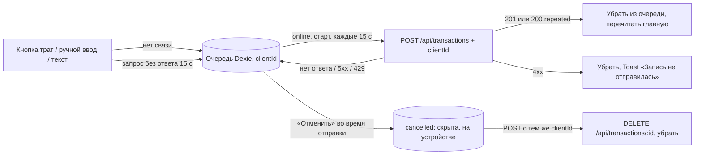

# API Request Lifecycle

Полный путь HTTP запроса от клиента до ответа через Express API.

## Request Flow

```
Client (React/HTTP) → Express Server → Middleware Stack → Router → Controller → Use Case → Repository → Database
                                                                                                              ↓
Client ← HTTP Response ← Error/Success Handler ← Controller ← Use Case ← Repository ← Database
```

## Детальные этапы

### 1. Client Request

**Пример:**
```http
POST /api/transactions HTTP/1.1
Host: localhost:3000
Content-Type: application/json

{
  "amount": 500,
  "type": "expense",
  "category": "groceries",
  "description": "Хлеб",
  "date": "2026-01-09",
  "userId": "131184740"
}
```

#### Без связи: очередь записей (FT-129)

Webapp пишет без связи: кнопки трат, ручной ввод и простой текст («такси 18к, кофе 25к», разбирается на устройстве) идут
не в запрос, а в очередь IndexedDB (Dexie, база `daftar-offline`, `shared/lib/offline`) — каждая запись со своим
`clientId` (FT-106). На главной она сразу видна с «Ждёт связи».



«Нет связи» — событие браузера `offline`, запись без ответа или «Записывать без связи» под медленной загрузкой; ответ
сервера на запись или `GET /api/health` (раз в 15 с, мимо кеша service worker) возвращает связь. Ответ считается
ответом сервера, если он не `5xx` или это JSON приложения: страница шлюза (туннель Cloudflare, прокси) с `502`/`503`/`504`
связь не возвращает.

«Отменить» во время отправки скрывает запись сразу и помечает её на устройстве `cancelled` (переживает перезапуск).
Дошла — удаляется на сервере; ответа не было — следующая отправка шлёт её с тем же `clientId` (сервер отдаёт уже
записанную, удалённую или нет) и удаляет, не показывая. Записи одной фразы в списке идут в порядке фразы. Ответы чтений главной и
счетов (остатки, итоги месяца, последние записи, частые траты, категории, курс, настройки) сохраняются на устройстве и
открывают их без связи; «Выйти» их забывает (`forgetCachedResponses`).

---

### 2. Express Server

**Entry Point:** [`src/delivery/web/express/expressServer.ts`](../../../src/delivery/web/express/expressServer.ts)

Server слушает на порту из `process.env.PORT` (default: 3000).

---

### 3. Middleware Stack (по порядку)

#### A. Request Logger
```typescript
function requestLogger(req, res, next) {
  console.log(`${req.method} ${req.url}`);
  const start = Date.now();
  // ...track response time
}
```

**Логирует:**
- HTTP method, URL
- User agent, IP address
- Response time
- Warning при > 5000ms

#### B. Security Headers
```typescript
function securityHeaders(req, res, next) {
  res.setHeader('X-Content-Type-Options', 'nosniff');
  res.setHeader('X-Frame-Options', 'DENY');
  res.setHeader('X-XSS-Protection', '1; mode=block');
}
```

#### C. CORS Headers
```typescript
function corsHeaders(req, res, next) {
  res.setHeader('Access-Control-Allow-Origin', '*');
  res.setHeader('Access-Control-Allow-Methods', 'GET, POST, PUT, DELETE, OPTIONS');
  res.setHeader('Access-Control-Allow-Headers', '...');
}
```

#### D. Body Parsers
```typescript
app.use(express.json({ limit: '10mb' }));
app.use(express.urlencoded({ extended: true, limit: '10mb' }));
```

**Файл:** [`src/delivery/web/express/middleware/errorMiddleware.ts`](../../../src/delivery/web/express/middleware/errorMiddleware.ts)

#### D2. Web session (FT-128)

Браузер вне Telegram входит через бота и получает httpOnly-cookie `daftar_session` (SameSite=Lax, `Path=/api`, 30
дней). `createWebSessionMiddleware` стоит сразу после парсеров, до всех роутеров и лимитов: находит сессию по хешу
cookie и кладёт её пользователя в `req.webSession`. Дальше вход определяется так (`requireAuth`, `optionalAuth`,
`signedInTelegramId`): вне production `X-Dev-User-Id`; есть заголовок `Authorization` — только он (`tma <initData>`
Mini App); нет заголовка — сессия браузера. Без всего этого — `401`.

**Файл:** [`src/delivery/web/express/middleware/webSessionMiddleware.ts`](../../../src/delivery/web/express/middleware/webSessionMiddleware.ts)

#### E. Rate limits (в каждом роутере, до его авторизации)

| Лимитер | Окно | Считает по | Лимит |
|---|---|---|---|
| `standardRateLimiter` — общий (FT-139) | 15 минут | пользователю Telegram: проверенный initData (`Authorization: tma …`), сессия браузера (FT-128), вне production — `X-Dev-User-Id` | 600 |
| | | адресу, если входа нет или initData не прошёл проверку | 100 |
| `aiRateLimiter` — разбор фраз, голос, быстрая запись | 15 минут | адресу | 20 |
| `readOnlyRateLimiter` — `/dashboard` | 15 минут | адресу | 300 |
| `strictRateLimiter` / `adminRateLimiter` | 15 минут | адресу | 10 / 5 |

Вход в браузере (FT-128): `POST /api/auth/web-login` — `strictRateLimiter` (10 ссылок с адреса за 15 минут), опрос
`GET /api/auth/web-login` — `readOnlyRateLimiter` (страница спрашивает раз в 3 секунды), остальное `/api/auth` —
общий.

Общий лимитер стоит перед авторизацией маршрута, поэтому вход проверяет сам — тем же правилом, что
`requireAuth` (`signedInTelegramId()` в `authMiddleware.ts`). Поддельный initData считается как запрос без
входа и не даёт отдельного счётчика. Ответ сверх лимита — `429 RATE_LIMIT_EXCEEDED`, заголовок
`RateLimit-Limit` называет действующий лимит. Счётчики в памяти процесса: перезапуск их обнуляет.

**Файл:** [`src/delivery/web/express/middleware/rateLimitMiddleware.ts`](../../../src/delivery/web/express/middleware/rateLimitMiddleware.ts)

---

### 4. Routing

**Base Path:** `/api`

```typescript
app.use('/api/transactions', transactionRoutes);
app.use('/api/voice', voiceRoutes);
app.use('/api/budgets', budgetRoutes);
app.use('/api/dashboard', dashboardRoutes);
app.use('/api/openai', openAIUsageRoutes);
```

**Route Matching:**
- `POST /api/transactions` → `transactionController.createTransaction`

**Файл:** [`src/delivery/web/express/routes/`](../../../src/delivery/web/express/routes/)

---

### 5. Controller

**Файл:** [`src/modules/transaction/presentation/transactionController.ts`](../../../src/modules/transaction/presentation/transactionController.ts)

```typescript
async function createTransaction(req, res, next) {
  try {
    // 1. Extract data
    const data = req.body;

    // 2. Validate
    const validation = TransactionValidator.validate(data);
    if (!validation.isValid) {
      return handleControllerError(
        ErrorFactory.validation('Invalid data', validation.errors),
        res
      );
    }

    // 3. Call Use Case
    const result = await createTransactionUseCase.execute(data);

    // 4. Handle result
    if (result.success) {
      return handleControllerSuccess(result.data, res, 201);
    } else {
      return handleControllerError(result.error, res);
    }
  } catch (error) {
    next(error); // Pass to error middleware
  }
}
```

**Responsibilities:**
- Request data extraction
- Input validation
- Use Case invocation
- Response formatting
- Error delegation

---

### 6. Use Case

**Файл:** [`src/modules/transaction/application/createTransaction.ts`](../../../src/modules/transaction/application/createTransaction.ts)

```typescript
class CreateTransactionUseCase {
  constructor(private repository: TransactionRepository) {}

  async execute(data: CreateTransactionData): Promise<Result<Transaction>> {
    try {
      // Business logic
      const id = await this.repository.save(data);
      const transaction = await this.repository.findById(id);

      return Result.success(transaction);
    } catch (error) {
      return Result.failure(error);
    }
  }
}
```

**Responsibilities:**
- Business logic execution
- Repository operations
- Error handling (wrapped in Result)

---

### 7. Repository

**Interface:** [`src/modules/transaction/domain/transactionRepository.ts`](../../../src/modules/transaction/domain/transactionRepository.ts)

**Implementations:**
- `SqliteTransactionRepository` - TypeORM
- `SupabaseTransactionRepository` - Supabase Client

```typescript
async save(transaction: Transaction): Promise<string> {
  // SQLite
  const entity = this.transactionRepository.create(transaction);
  const saved = await this.transactionRepository.save(entity);
  return saved.id.toString();

  // Supabase
  const { data, error } = await supabase
    .from('transactions')
    .insert([transaction])
    .select()
    .single();
  return data.id;
}
```

---

### 8. Database

**SQLite:**
- Connection pool через TypeORM
- Location: `data/database.sqlite`
- Auto-sync in development

**Supabase:**
- PostgreSQL via REST API
- Connection через Supabase Client
- UUID primary keys

**Transaction Stored:**
```sql
INSERT INTO transactions (
  amount, type, description, date,
  category, user_id, created_at
) VALUES (
  500, 'expense', 'Хлеб', '2026-01-09',
  'groceries', '131184740', NOW()
) RETURNING id;
```

---

### 9. Response Formatting

**Success Response:**
```typescript
function handleControllerSuccess(data, res, statusCode = 200) {
  res.status(statusCode).json({
    success: true,
    data: data,
    timestamp: new Date().toISOString()
  });
}
```

**Example:**
```json
{
  "success": true,
  "data": {
    "id": "123",
    "amount": 500,
    "type": "expense",
    "category": "groceries",
    "description": "Хлеб",
    "date": "2026-01-09",
    "userId": "131184740"
  },
  "timestamp": "2026-01-09T10:30:00.000Z"
}
```

**Файл:** [`src/shared/infrastructure/utils/controllerHelpers.ts`](../../../src/shared/infrastructure/utils/controllerHelpers.ts)

---

## Error Handling Flow

### Use Case Error
```typescript
// Repository throws error
throw ErrorFactory.notFound('Transaction', id);

// Use Case catches
return Result.failure(error);

// Controller checks
if (!result.success) {
  handleControllerError(result.error, res);
}
```

### Controller Error
```typescript
function handleControllerError(error, res) {
  if (error instanceof ValidationError) {
    return res.status(400).json({ ... });
  }
  if (error instanceof NotFoundError) {
    return res.status(404).json({ ... });
  }
  // ...
}
```

### Unhandled Error → Error Middleware
```typescript
function errorHandler(err, req, res, next) {
  console.error(err);

  // Structured error response
  res.status(err.statusCode || 500).json({
    success: false,
    error: {
      code: err.code || 'INTERNAL_ERROR',
      message: err.message,
      timestamp: new Date().toISOString()
    }
  });
}
```

**Файл:** [`src/delivery/web/express/middleware/errorMiddleware.ts`](../../../src/delivery/web/express/middleware/errorMiddleware.ts)

---

## Error Response Format

```json
{
  "success": false,
  "error": {
    "code": "VALIDATION_ERROR",
    "message": "Invalid transaction data",
    "timestamp": "2026-01-09T10:30:00.000Z",
    "context": {
      "field": "amount",
      "reason": "must be positive"
    }
  }
}
```

---

## Middleware Order (ВАЖНО!)

```
1. requestLogger        - Logging
2. securityHeaders      - Security
3. corsHeaders          - CORS
4. express.json()       - Body parsing
5. express.urlencoded() - Form parsing
6. Routes               - Application routes
7. notFoundHandler      - 404 handling
8. errorHandler         - Error handling
```

**Порядок критичен:** body parsers должны быть до routes!

---

## Performance Optimizations

### Request Timing
```typescript
const start = Date.now();
res.on('finish', () => {
  const duration = Date.now() - start;
  if (duration > 5000) {
    console.warn(`Slow request: ${duration}ms`);
  }
});
```

### Response Caching
- OpenAI Usage data кешируется на 5 минут
- Analytics queries могут кешироваться

### Connection Pooling
- TypeORM автоматически управляет connection pool
- Supabase client использует HTTP keep-alive

---

## Security Considerations

### Implemented
✅ Security headers (XSS, frame options)
✅ CORS headers
✅ Request size limits (10MB)
✅ Input validation на controller level
✅ Error message sanitization (no stack traces)
✅ Rate limits per Telegram user / per address (see 3.E)

### Missing (TODO)
⚠️ Authentication/Authorization (no JWT)
⚠️ Request signing/verification
⚠️ SQL injection protection (use parameterized queries)

---

## Критичные файлы

- [`src/delivery/web/express/expressServer.ts`](../../../src/delivery/web/express/expressServer.ts) - Server setup
- [`src/delivery/web/express/middleware/errorMiddleware.ts`](../../../src/delivery/web/express/middleware/errorMiddleware.ts) - Error handling
- [`src/shared/infrastructure/utils/controllerHelpers.ts`](../../../src/shared/infrastructure/utils/controllerHelpers.ts) - Response helpers
- [`src/modules/*/presentation/*Controller.ts`](../../../src/modules/) - Controllers

---

## См. также

- [Voice → Transaction](voice-to-transaction.md) - Telegram bot flow
- [Budget Calculation](budget-calculation.md) - Cross-repository calculations
- [Architecture Overview](../01-architecture/overview.md) - Clean Architecture layers
