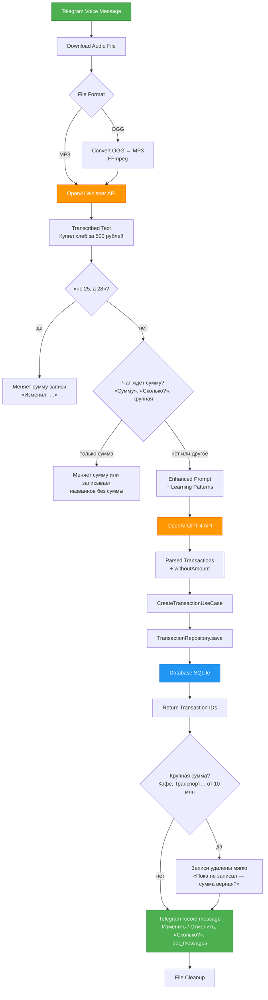

# Voice → Transaction Flow

Полный процесс преобразования голосового сообщения в транзакцию с использованием AI.

> **С FT-099 (веха 10).** Промпт перечисляет *видимые категории пользователя* их текущими названиями,
> с синонимами старых категорий как подсказками (`buildCategoryPrompt`); ИИ отвечает названием, а
> `CreateTransactionUseCase` через `CategoryResolver` находит категорию пользователя (скрытые не выбираются,
> нераспознанное — «Другое»). Выученные паттерны хранят ключи стартовых категорий и показываются в
> названиях пользователя. Разбор долгов выключен (решение Д2): «одолжил», «кредит», «рассрочка» — расход
> в «Другое». Суммы сохраняются в `amount_minor` (FT-097). Ниже — исходная схема, детали категорий в ней
> устарели.
>
> **С FT-103.** После разбора `captureMoneyOf` для каждой записи определяет валюту («$», «долл» — USD), вид
> счёта («нал», «картой») и «45» → 45 000 сум; во фразе из нескольких записей — по данным разбора для каждой.
> `AccountBook.resolveForRecord` выбирает счёт (названный в тексте, по виду, по валюте, по умолчанию). Запись
> сохраняет `source` (`telegram` у бота) и `currency`; ответ содержит `assumptions` (`captureAssumptions`).
> Доллары без долларового счёта остаются в USD на счёте по умолчанию с `needsReview`.
>
> **С FT-138.** Догадка о категории (`assumptions: { kind: "category" }`, «?» на проверке и «Покупки?» в
> боте) — у категории, которую не назвало ни одно слово записи: не у той, что дали название категории, слово
> словаря (`presetSynonyms`) или выученный паттерн (`TransactionLearningService.learnedCategoryWords` —
> псевдонимы мерчантов и слова паттернов, что указывают на категорию, `namingWordsOf`) (`categoryGuess.ts`).
> Это категория, которую ИИ выбрал сам, и «Другое» для слова, которое быстрый разбор не узнал; перевод,
> накопление и снятие наличных быстрый разбор кладёт в «Другое» по виду — без догадки. Правило —
> `docs/pastel/api.md`.

## Общий поток



## Детальные шаги

### 1. Получение голосового сообщения
**Handler:** Telegram Bot `bot.on('voice', ...)`

- Пользователь отправляет voice message в Telegram
- Telegram Bot получает voice file metadata
- File ID используется для скачивания

**Файл:** [`src/delivery/messaging/telegram/telegramBot.ts:140`](../../../src/delivery/messaging/telegram/telegramBot.ts)

---

### 2. Download Audio File
**Method:** `bot.telegram.getFileLink(fileId)`

- Primary: Сохранение в `DOWNLOADS_PATH` (настраиваемая директория)
- Fallback: OS temp directory (`os.tmpdir()`)
- Timeout: 30 секунд
- Error handling: Retry с alternative location

---

### 3. Audio Conversion (OGG → MP3)
**Method:** `ProcessVoiceInputUseCase.convertOggToMp3()`

**Primary Strategy - FFmpeg:**
```bash
ffmpeg -i input.ogg -acodec libmp3lame -ab 128k output.mp3
```

**Fallback Strategy:**
- Если FFmpeg недоступен: простое переименование файла
- Whisper API может обработать OGG, но MP3 надежнее

---

### 4. OpenAI Whisper Transcription
**Service:** `OpenAITranscriptionService.transcribe()`

**API Call:**
```typescript
const transcription = await openai.audio.transcriptions.create({
  file: fs.createReadStream(filePath),
  model: "whisper-1",
  language: "ru",
  response_format: "json"
});
```

**Output Example:**
```
"Купил хлеб в магазине Пятерочка за пятьсот рублей"
```

**Файл:** [`src/modules/voiceProcessing/infrastructure/openAITranscriptionService.ts:24`](../../../src/modules/voiceProcessing/infrastructure/openAITranscriptionService.ts)

**Открытый вопрос «Сумму» (FT-122).** До разбора услышанный текст отдаётся боту
(`ProcessVoiceInputUseCase.execute(input, { takeHeardText })`): если под записью открыт вопрос «Напишите новую
сумму» и голосовое — только сумма («150 тысяч»), бот меняет сумму записи, и ничего не разбирается и не пишется.
Любое другое голосовое закрывает вопрос — сообщение возвращается на «Изменить» — и записывается как обычно.
Команда тоже сначала закрывает вопрос (`closeAmountQuestionOnCommand` перед обработчиками команд). Текстовый
ответ на вопрос стоит перед проверкой бесплатного лимита: он исправляет запись, а не добавляет новую.

---

### 5. Enhanced Prompt with Learning Patterns
**Service:** `TransactionLearningService.getEnhancedPrompts()`

**Система обучения:**
- Читает runtime-паттерны из ignored `data/patterns.json`; если файла нет, использует tracked seed `data/patterns.seed.json`
- Добавляет learned category keywords
- Добавляет merchant aliases
- Улучшает точность парсинга на основе прошлых исправлений

**Enhanced Prompt Example:**
```
You are a financial assistant. Parse this text into transaction.
Today is 2026-01-09, Friday. The last 7 days: Friday 2026-01-09, Thursday 2026-01-08, …

Learned patterns:
- "хлеб", "молоко" → category "groceries"
- "Пятерочка", "5ка" → merchant "Пятёрочка"

Text: "Купил хлеб в магазине Пятерочка за пятьсот рублей"
```

**«Сегодня» — день пользователя (FT-175).** Это день по календарю пользователя (Ташкент), а не UTC: раньше
`toISOString()` с 00:00 до 05:00 по Ташкенту давал вчерашний день. У фразы из очереди телефона
(`POST /api/quick-capture` с `capturedAt`) это день ввода, а не день, когда фраза дошла; запись без даты получает его.
Быстрые пути текста (`такси 18к`) читают «сегодня», «вчера», «позавчера» сами, другой день во фразе отдают ИИ —
[QUICK_CAPTURE_API.md](../../QUICK_CAPTURE_API.md#time-of-input-capturedat).

**Как читается число фразы (FT-185).** Одно правило — `readWrittenNumber` (`voiceProcessing/domain/writtenNumber.ts`).
Его берут быстрый путь, сверка суммы с валютой в тексте, правило «голое число — тысячи» и пометка «понял как 45 000».
- Пробелы, и неразрывные тоже, делят тысячи.
- Запятая перед одной-двумя последними цифрами — копейки: `28 000,00 UZS` из Wallet — 28 000, `4,50 $` — 4,5. Любая
  другая запятая делит тысячи: `150,000` — 150 000.
- Точку читает `Number`. Фразу с точкой (`4.50 USD`) и запятую рядом с «млн»/«к» (`3,2 млн`) быстрый путь отдаёт ИИ.

Раньше запятая выбрасывалась всегда, и `28 000,00` записывалось как 2 800 000.

Что дальше делает с суммой `captureMoneyOf`, у текста и голоса одинаково (решения Шукура 2026-10-30):
- **Голое число меньше 1000 в сумах у расхода — тысячи**, дробь тоже: «кофе 45» — 45 000, «кофе 1,5» — 1 500,
  «12,50» — 12 500, с пометкой «понял как». Так же читает ответ на «Сколько?» (`amountReply.ts`). Доходы и доллары —
  как написаны.
- **В сумах дробей нет**: тийины округляются до целого сума, половина — вверх. «1 234,50 сум» — 1 235, «28 000,00» —
  ровно 28 000. Доллары сохраняют центы. Готовая оплата Apple Pay (`/api/quick-capture/payment`) округляет так же.

---

### 6. OpenAI GPT-4 Transaction Parsing
**Service:** `OpenAITranscriptionService.analyzeTransactions()`

**API Call:**
```typescript
const response = await openai.chat.completions.create({
  model: "gpt-4.1-mini", // AppConfig.OPENAI_MODEL
  messages: [
    { role: "system", content: enhancedSystemPrompt },
    { role: "user", content: text }
  ],
  response_format: { type: "json_object" }
});
```

**Output Example:**
```json
{
  "transactions": [{
    "amount": 500,
    "type": "expense",
    "category": "groceries",
    "description": "Хлеб",
    "merchant": "Пятёрочка",
    "date": "2026-01-09",
    "confidence": 0.85
  }]
}
```

---

### 7. Confidence Scoring

**Dynamic Confidence Calculation:**

```typescript
let confidence = 0.95; // Base confidence

// Снижение за отсутствующие поля
if (!merchant) confidence -= 0.1;
if (!category || category === 'other') confidence -= 0.15;
if (description.length < 3) confidence -= 0.05;

// Confidence range: 0.0 - 1.0
```

**Decision Logic:**
- **High confidence (≥ 0.6):** Автосохранение с опциями Edit/Delete
- **Low confidence (< 0.6):** Запрос подтверждения у пользователя

---

### 8. Transaction Creation
**Use Case:** `CreateTransactionUseCase.execute()`

**Steps:**
1. Валидация данных (amount > 0, valid date, etc.)
2. Enrichment (userId, timestamp)
3. Repository save
4. Возврат transaction ID

**Файл:** [`src/modules/transaction/application/createTransaction.ts`](../../../src/modules/transaction/application/createTransaction.ts)

---

### 9. Database Storage
**Repository:** `TransactionRepository.save()`

**SQLite:**
- TypeORM insert через `repository.save()`
- Auto-increment ID

**Supabase:**
- PostgreSQL insert через Supabase client
- UUID generation

**Stored Fields:**
```typescript
{
  id, amount, type, description, date,
  merchant, confidence,
  originalText: "Купил хлеб...",
  originalParsing: { /* GPT response */ },
  userId, createdAt, updatedAt
}
```

---

### 10. Telegram Response
**Handler:** Telegram Bot — `sendRecordMessage` (`src/delivery/messaging/telegram/utils/recordMessageView.ts`)

Одно сообщение на всю фразу (FT-122, `docs/pastel/components/BotRecord.md`): записи читаются из базы, без эмодзи,
дата всегда абсолютная, голосовое — с цитатой того, что бот расслышал. Связь «сообщение → записи» и открытый
экран кнопок хранятся в `bot_messages` (BotMessageModule), поэтому кнопки и `/undo` работают после перезапуска.

```
Расход −186 400 сум              ← жирным
Продукты · «Супермаркет»
Карта · 14 октября
┃ Расслышал: «Супермаркет сто восемьдесят шесть тысяч четыреста, картой»

[Изменить] [Отменить]
```

Несколько записей: «Расходы −43 000 сум · 2 записи», строка на запись, кнопка на запись и «Отменить все».
«Изменить» → «Сумму | Категорию», «Счёт | Дату», «Открыть в Kapelka ↗», «Готово», «Отменить запись»; поле — за два
нажатия, категории по 2 в ряд. «Отменить» удаляет запись мягко и зачёркивает её с «Вернуть»; `/undo` делает то же с
последним сообщением чата, где есть записи. Уверенность разбора кнопки больше не меняет; угаданная категория
показана с «?» (FT-138).

**Уточнения (FT-123,** доски «Бот · когда ИИ не уверен», «Бот · не понял, не расслышал»**):**
- Одна запись с угаданной категорией — «Записал в «Покупки» — верно?» и «Да, верно | Другая»; угаданное «Другое» —
  «Категорию не узнал — записал в «Другое».» и «Выбрать категорию». «‹ Назад» из категорий ведёт к вопросу.
- «45» → 45 000 — курсивом под суммой «"45" понял как 45 000 сум.», у записи в списке — «−45 000?».
- Названное без суммы (`withoutAmount` разбора) не записывается: «"Такси" — без суммы. Сколько? Напишите числом.»,
  «Пропустить «Такси»» (без записей — «Не записывать»). Ответ суммой («18к нал») записывает его через
  `QuickCaptureService.captureWithAmount` новым сообщением, следующий пропуск спрашивается там же; любой другой текст,
  голос или команда закрывают вопрос строкой «— без суммы, не записал.». Ответ добавляет запись, поэтому проверяет
  лимит записей (`checkTelegramLimit`); «Сумму» его не проверяет. Названное без суммы — тоже позиция фразы: «нал»,
  «$» и слова категории в «кофе 25к, такси нал» относятся не к кофе (`itemCount` считает и пропуски).
- Крупная сумма (`isSuspiciouslyLarge`: расход в сумах от 10 000 000 в Кафе, Транспорте, Продуктах, Связи,
  Здоровье) держит всё сообщение: записи удалены мягко, пока не ответят «Это 25 000 сум», «Да, верная» (записи
  возвращаются) или «Не записывать» (крупная остаётся удалённой, остальные возвращаются). Сумму можно и написать;
  другой текст убирает только подсказку «Если сумма другая — напишите её». Кнопки действуют, только пока вопрос
  открыт: второе нажатие или старая клавиатура ничего не меняют («Пропустить» несёт число ещё спрашиваемых позиций).
  Если вопрос не ушёл в чат или не запомнился в `bot_messages`, записи возвращаются как написаны.
- «не 25, а 28» — ответом на подтверждение, на открытый вопрос или по сумме последней такой записи — меняет сумму, как
  «Сумму». В «Изменить» подсказка: «Сумму можно и текстом: «не 145 000, а …».».
- Чата один вопрос за раз: открытый вопрос — колонка `bot_messages.question`.
- Ничего не нашёл в тексте или в расслышанном голосовом — «Не нашёл, что записать.» с примером фразы; в голосовом
  нет слов — «Не расслышал.» с примером.

---

### 11. File Cleanup
**Method:** `fs.unlinkSync()`

- Удаление original OGG file
- Удаление converted MP3 file
- Error handling для cleanup failures

---

## Error Handling

### Telegram Download Errors
- Retry с alternative directory
- Timeout после 30 секунд
- User-friendly message об ошибке

### Голосовое, присланное снова (FT-167)
- Записи голосового несут client id сообщения `tg-<bot id>-<chat id>-<message id>` (`<id>`, `<id>:1`, …). Если бот
  перезапустился, не подтвердив сообщение Telegram, тот пришлёт его снова: `createRepeatedMessageGuard` находит записи
  по этому id (или ответ на «Сумму» — `answeredBy` в `bot_messages`), и голосовое не скачивается, не распознаётся и не
  записывается второй раз; подтверждение уходит, только если его ещё нет в `bot_messages`

### OpenAI API Errors
- Таймаут `OPENAI_TIMEOUT_MS` (20 с) для текста и голоса и `OPENAI_MAX_RETRIES` (1 повтор) для текста (FT-145). Голос
  не повторяется: SDK собирает загрузку файла один раз и повтор ушёл бы пустым. Без этих настроек SDK ждал бы
  10 минут и повторял дважды — до 30 минут на одну фразу
- Сбой или таймаут → `ExternalServiceError`: бот отвечает «Не получилось разобрать… не записал», причина — в логе
  (`errorContext`). Простая фраза, чья подпись не называет категорию («стрижка 50000»), записывается в «Другое ?»;
  в логе `warn` «The AI could not read a simple phrase» с той же причиной — `errorContext.originalError`, например
  «Request timed out.» (FT-165). Подпись, которая называет категорию («такси 18000» — «Транспорт»), до ИИ не доходит
- Rate limit handling
- Invalid API key detection

### FFmpeg Not Available
- Fallback на file rename
- Whisper может обработать OGG

### Parsing Failures
- Возврат пустого массива транзакций
- User notification о проблеме
- Logging для debugging

---

## Performance Considerations

**Bottlenecks:**
1. OpenAI API calls (2-5 seconds каждый)
2. File download (зависит от размера)
3. FFmpeg conversion (1-2 секунды)

**Optimizations:**
- Кеширование learned patterns
- Асинхронная обработка
- Parallel API calls (если несколько транзакций)

---

## Learning System Integration

**After User Correction:**

Если пользователь редактирует auto-saved транзакцию:

1. `UpdateTransactionWithLearningUseCase` вызывается
2. `TransactionLearningService.recordCorrection()` сохраняет:
   - Original parsing (что AI распознал)
   - User correction (что пользователь исправил)
   - Timestamp и userId
3. `updatePatterns()` обновляет ignored runtime-файл `data/patterns.json`; tracked seed остаётся неизменным
4. Следующие парсинги используют улучшенные patterns

---

## Критичные файлы

- [`src/modules/voiceProcessing/application/processVoiceInput.ts`](../../../src/modules/voiceProcessing/application/processVoiceInput.ts) - Main use case
- [`src/modules/voiceProcessing/infrastructure/openAITranscriptionService.ts`](../../../src/modules/voiceProcessing/infrastructure/openAITranscriptionService.ts) - OpenAI integration
- [`src/delivery/messaging/telegram/telegramBot.ts`](../../../src/delivery/messaging/telegram/telegramBot.ts) - Telegram handlers
- [`src/shared/application/learning/transactionLearning.ts`](../../../src/shared/application/learning/transactionLearning.ts) - ML service

---

## См. также

- [API Lifecycle](api-lifecycle.md) - HTTP request flow
- [Architecture Overview](../01-architecture/overview.md) - Clean Architecture layers
- [Modules](../01-architecture/modules.md) - VoiceProcessingModule details
- [Оплата Apple Pay](../../QUICK_CAPTURE_API.md#payments-post-apiquick-capturepayment) - FT-176: оплата из Wallet
  приходит готовой суммой и мимо разбора (`RecordPaymentUseCase`); ИИ выбирает только категорию по магазину.
  `originalText` записи — магазин, но исправление в Mini App пока ничему не учит — ни оплату, ни фразу (FT-184)
